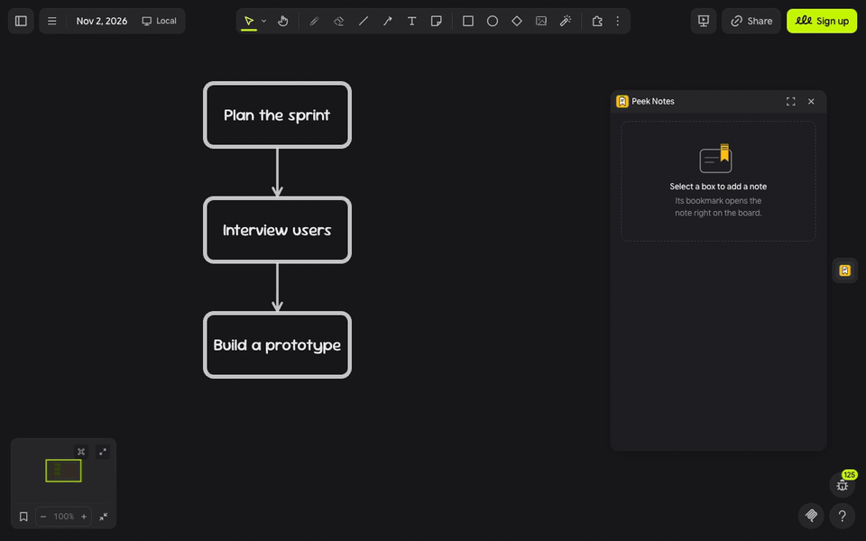

# Peek Notes |ω･)ﾉ

**keep the board tidy, keep the details.**

Peek Notes tucks the long version inside any box, so your board shows only the headlines. A little bookmark peeks over the box's edge, and one click opens the details and sources right beside it ♡

---

## let's tuck ٩(◕‿◕)۶

1. Click the **bookmark** in the extension rail.
2. Select a box, shape, sticky note or frame, then write the long version under **Details** and your links, books or people under **Sources**, one per line.
3. Click **Save note**, or press `⌘ Enter`. A bookmark peeks over the box's top edge.
4. Click the bookmark, or select the box, to open the note beside it. Click away or press **×** to tuck it away again.

> (・_・;) **a teammate can't see the bookmarks?** Notes are saved with the board, but the bookmarks and notes only show for people who have Peek Notes installed.

---

## make it yours (｡•̀ᴗ-)✧

- **Sources**: links show as tidy addresses like _nngroup.com/articles_, and books or people get a line of their own.
- **Edit**: the pencil on an open note takes you straight to it in the panel.
- **On this board**: every note in one list; click one to fly to its box.
- **Long notes**: the board shows the first 14 lines and the panel holds the rest, up to 4,000 characters.

---

## little things to try (っ˘ω˘ς )

- A workflow where every step keeps its checklist tucked inside.
- A research map with the quote and the link behind each finding.
- Lesson cards that hide the teacher's notes until class.
- A study board in Thai or English: long notes wrap neatly in both.

---

**the small print**: the panel loads its font from jsDelivr and fetches nothing else; nothing you draw or type leaves your board. Notes are saved inside the board, on the box they belong to, so everyone who can open the board has them; links in a note are shown as text and never opened or fetched. The logo and bookmark were drawn for Peek Notes. Code [MIT](https://github.com/mickyngub/drawdy-peek-notes/blob/main/LICENSE); building it yourself? See [DEVELOPMENT.md](https://github.com/mickyngub/drawdy-peek-notes/blob/main/DEVELOPMENT.md).
